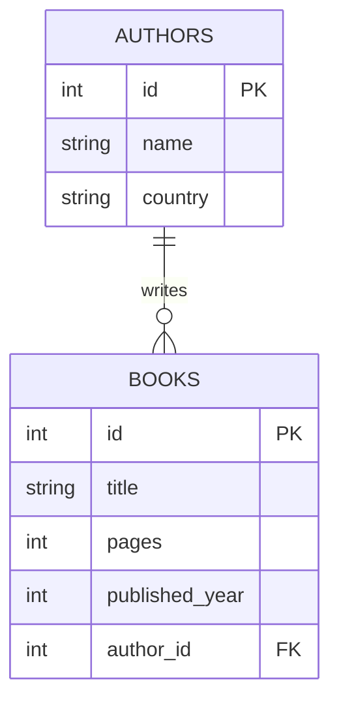
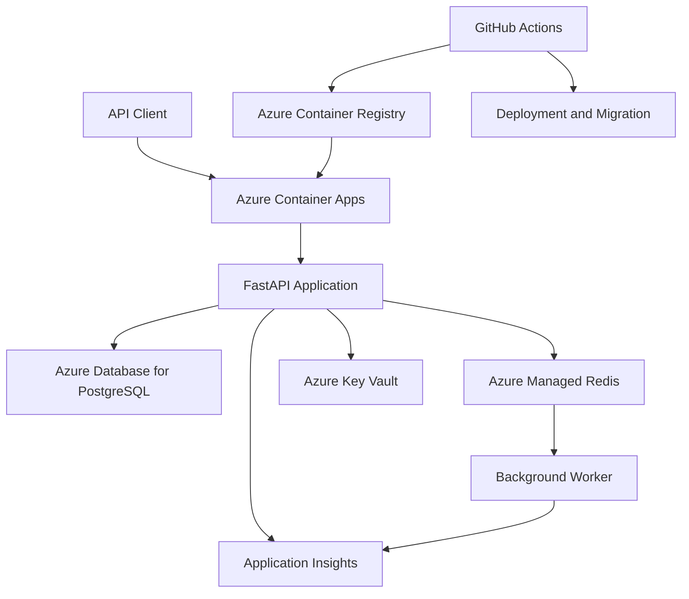

# LibraryCore
### Backend Engineering & Cloud Platform

**LibraryCore** is a production-oriented backend engineering project built with Python and FastAPI. It is being developed to explore real-world backend engineering challenges involving relational database design, authentication, concurrency, caching, reliability, performance optimization and cloud deployment.

The goal is to evolve a basic library management API into a multi-user backend platform with production-style engineering practices.

**Status:** In Development  
**Target completion:** December 15, 2026

---

## Project Objectives

LibraryCore focuses on backend engineering problems beyond basic CRUD operations.

Key engineering areas:

- Relational database design and transaction management.
- Authentication, authorization and resource ownership.
- Concurrency control and idempotent operations.
- Database indexing and query optimization.
- Redis caching and cache invalidation.
- Rate limiting and background job processing.
- API reliability and structured error handling.
- Containerization and CI/CD.
- Cloud deployment and application monitoring.
- Load testing and performance analysis.

---

## Technology Stack

### Currently Implemented

| Category | Technology |
|---|---|
| Language | Python |
| Backend Framework | FastAPI |
| ORM | SQLAlchemy |
| Data Validation | Pydantic |
| Database | SQLite |

### Planned Technology Stack

| Category | Technology |
|---|---|
| Database | PostgreSQL |
| Database Migrations | Alembic |
| Caching | Redis |
| Background Processing | RQ |
| Authentication | JWT, RBAC |
| Containerization | Docker, Docker Compose |
| CI/CD | GitHub Actions |
| Container Registry | Azure Container Registry |
| Cloud Deployment | Azure Container Apps |
| Secrets Management | Azure Key Vault |
| Monitoring | Application Insights, Azure Monitor |
| Testing | Pytest |
| Load Testing | Locust |

---

## Current Implementation

The application currently contains two primary entities: Authors and Books.

### Database Models

**Author**

| Field | Description |
|---|---|
| id | Primary key, database-generated |
| name | Author name |
| country | Author's country |

**Book**

| Field | Description |
|---|---|
| id | Primary key |
| title | Book title |
| pages | Number of pages |
| published_year | Year of publication |
| author_id | Foreign key referencing Authors |

### Database Relationship

An Author can have multiple Books, while each Book belongs to one Author.



### Pydantic Schemas

Request and response validation is implemented using Pydantic.

**Author**
- `AuthorBase`
- `AuthorCreate`
- `AuthorResponse`

**Book**
- `BookBase`
- `BookCreate`
- `BookResponse`

The schemas separate incoming request data from database models and API response representations.

### Implemented API Operations

| Entity | Operation | Status |
|---|---|---|
| Authors | Create | Implemented |
| Authors | Read all | Implemented |
| Authors | Read one | Implemented |
| Books | Create | Implemented |
| Books | Read all | Implemented |
| Books | Read one | Implemented |
| Books | Update | Planned |
| Books | Delete | Planned |
| Authors | Update | Planned |
| Authors | Delete | Planned |

---

## Planned Database Architecture

The database will evolve to support multiple users, authentication, ownership and reliable request processing.

The target design consists of five core tables:

| Table | Responsibility |
|---|---|
| Users | Authentication, roles and account management |
| Authors | Shared author catalogue |
| Books | Books associated with authors and individual users |
| IdempotencyRecords | Prevent duplicate operations during request retries |
| RefreshTokens | Refresh-token rotation and revocation |

The database will use PostgreSQL with Alembic migrations.

The design will incorporate foreign keys, unique constraints, indexes, transaction management and appropriate concurrency controls.

---

## Planned Engineering Capabilities

### 1. Backend and Database Engineering

- Complete CRUD operations.
- PostgreSQL integration.
- Alembic database migrations.
- Database constraints and indexing.
- Transaction management and rollback.
- Pagination, filtering and sorting.
- N+1 query investigation.
- Query optimization using `EXPLAIN ANALYZE`.

### 2. Authentication and Authorization

- User registration and login.
- Secure password hashing.
- JWT access and refresh tokens.
- Refresh-token rotation and revocation.
- Role-Based Access Control (Admin/User).
- User-specific resource ownership.
- Protected API endpoints.

### 3. API Reliability and Consistency

- Structured error handling.
- Consistent HTTP status codes.
- Idempotent write operations.
- Concurrent request handling.
- Database locking and transaction isolation.
- Request correlation IDs.
- Structured application logging.

### 4. Redis and Background Processing

**Caching**
- Redis cache-aside implementation.
- TTL-based expiration.
- Cache invalidation.
- Cache consistency and failure handling.

**Rate Limiting**
- Redis-backed rate limiting.
- User-based and IP-based limits.
- Atomic rate-limit operations.

**Background Jobs**
- Independent RQ workers.
- Asynchronous CSV export or report generation.
- Job failure handling and retries.
- Job status tracking.

### 5. Testing and Quality Assurance

- Unit testing with Pytest.
- PostgreSQL and Redis integration tests.
- Authentication and authorization testing.
- Transaction and concurrency testing.
- Idempotency testing.
- Cache invalidation testing.
- Background job testing.
- API validation and error handling tests.

### 6. Docker and CI/CD

- Production-oriented Dockerfiles.
- Docker Compose for local development.
- Independent API and worker containers.
- Automated testing through GitHub Actions.
- Docker image building and publishing.
- Automated deployment pipeline.

---

## Azure Cloud Architecture

The target deployment architecture will use Microsoft Azure.



### Planned Azure Services

| Service | Purpose |
|---|---|
| Azure Container Apps | Host the FastAPI application and background worker |
| Azure Container Registry | Store Docker images |
| Azure Database for PostgreSQL | Managed relational database |
| Azure Managed Redis | Caching, rate limiting and job queues |
| Azure Key Vault | Secure application secrets |
| Managed Identity | Service-to-service authentication |
| Application Insights | Application telemetry and diagnostics |
| Azure Monitor | Infrastructure and resource monitoring |

The deployment will include health checks, structured logging, monitoring and controlled database migrations.

---

## Performance and Load Testing

Performance will be evaluated using Locust.

The objective is to measure actual application behaviour under concurrent workloads.

Metrics:

- Requests per second (throughput).
- p50 response latency.
- p95 response latency.
- p99 response latency.
- Error rate.
- Database query performance.
- Cached versus uncached response performance.

Performance reports will document:

- Test environment and resource configuration.
- Dataset size.
- Concurrent user count.
- Test duration.
- Identified bottlenecks.
- Optimizations performed.
- Before-and-after measurements.

No performance improvements will be claimed without measured results.

---

## Project Roadmap

| Period | Milestone |
|---|---|
| Nov 18–22 | Complete CRUD, PostgreSQL and Alembic |
| Nov 23–28 | Authentication, RBAC and ownership |
| Nov 29–Dec 3 | Idempotency and API reliability |
| Dec 4–7 | Redis, caching and background jobs |
| Dec 8–10 | Testing, Docker and GitHub Actions |
| Dec 11–13 | Azure deployment and monitoring |
| Dec 14–15 | Load testing, documentation and final verification |

**Target completion: December 15, 2026.**

---

## Running Locally

### Prerequisites

- Python
- uv package manager

### Installation

Clone the repository:

```bash
git clone https://github.com/Soumya98-dev/Personal-Library-API.git
cd Personal-Library-API
```

Install project dependencies:

```bash
uv sync
```

Start the development server:

```bash
uv run uvicorn main:app --reload
```

The API documentation will be available at:

- Swagger UI: http://127.0.0.1:8000/docs
- ReDoc: http://127.0.0.1:8000/redoc

---

## Engineering Principles

LibraryCore is being developed with the following principles:

1. **Correctness over complexity:** Prefer simple, correct implementations over unnecessary abstractions.
2. **Consistency:** Maintain data integrity across transactions and concurrent operations.
3. **Security:** Implement proper authentication, authorization and secrets management.
4. **Performance:** Optimize based on measurements rather than assumptions.
5. **Reliability:** Design for database failures, Redis unavailability and background job failures.
6. **Observability:** Make application behaviour measurable and debuggable.
7. **Incremental development:** Implement, test and validate one capability at a time.

---

## Project Goal

The final objective is to build a backend system that demonstrates practical knowledge of Python backend development, relational databases, distributed processing, cloud infrastructure, application reliability and performance engineering.

Rather than focusing on the number of technologies used, LibraryCore prioritizes understanding the engineering decisions and trade-offs behind a production-style backend application.

**Built with Python, FastAPI and a focus on backend engineering.**
